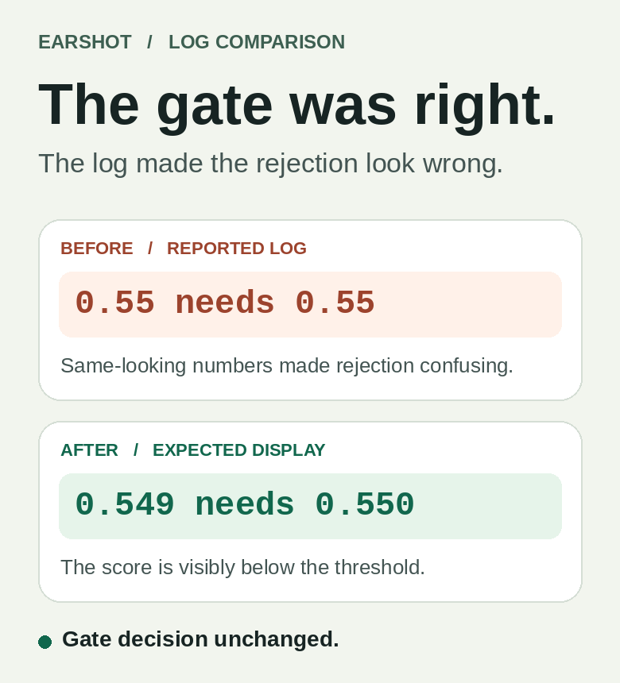
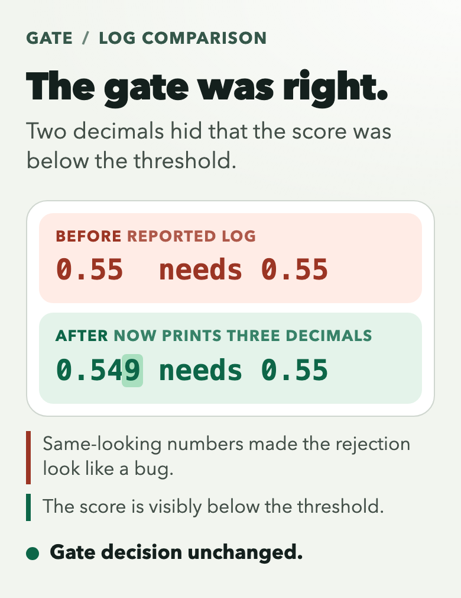
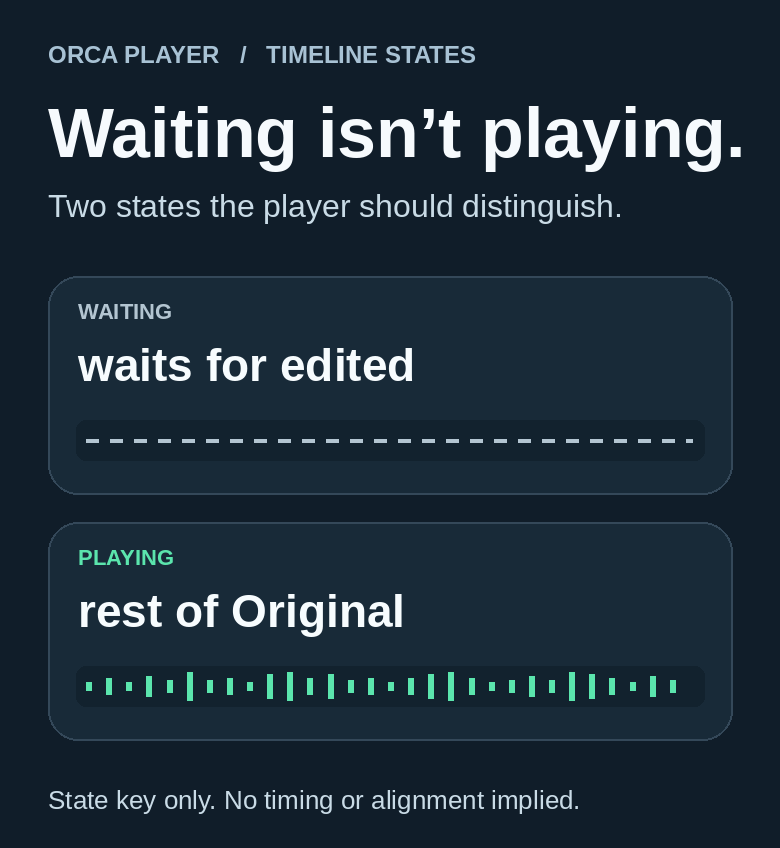
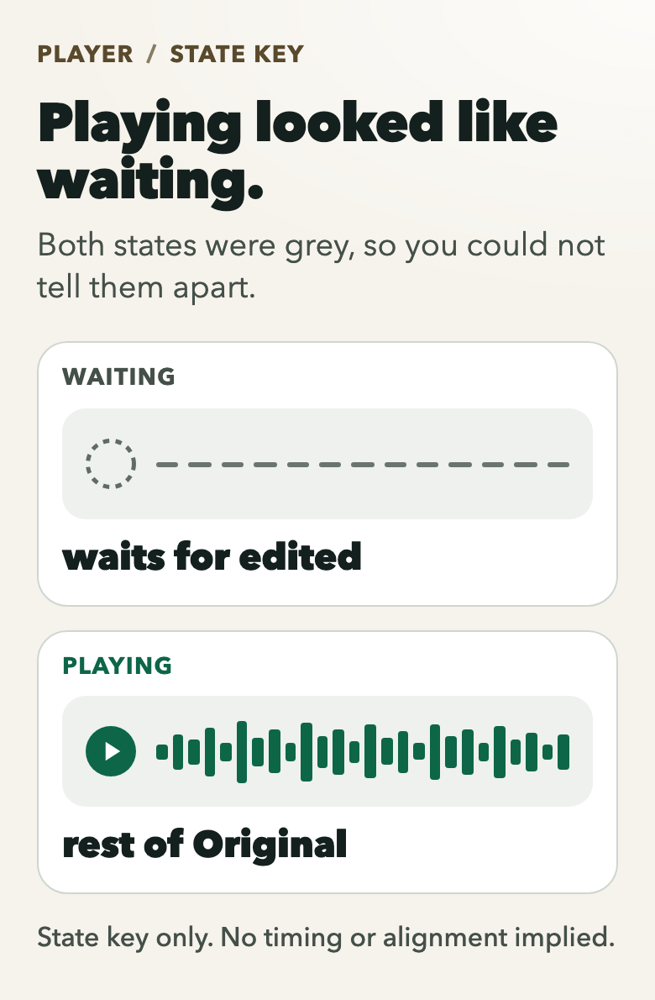
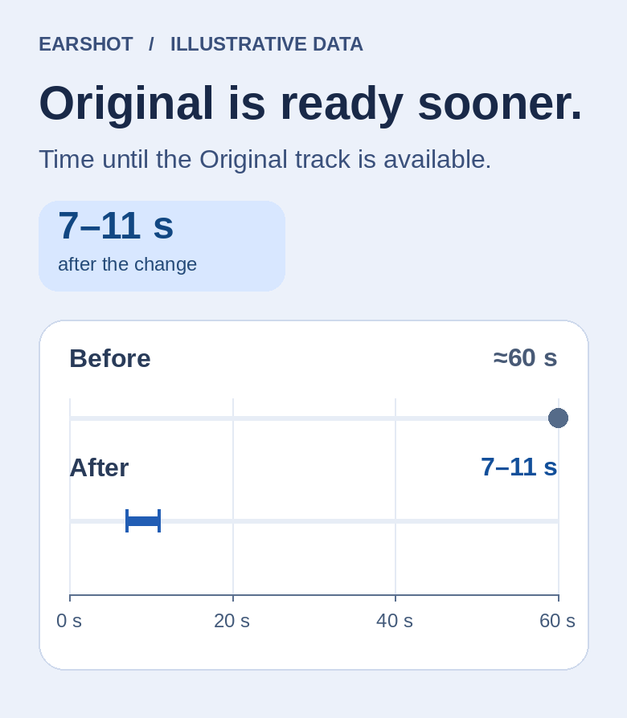
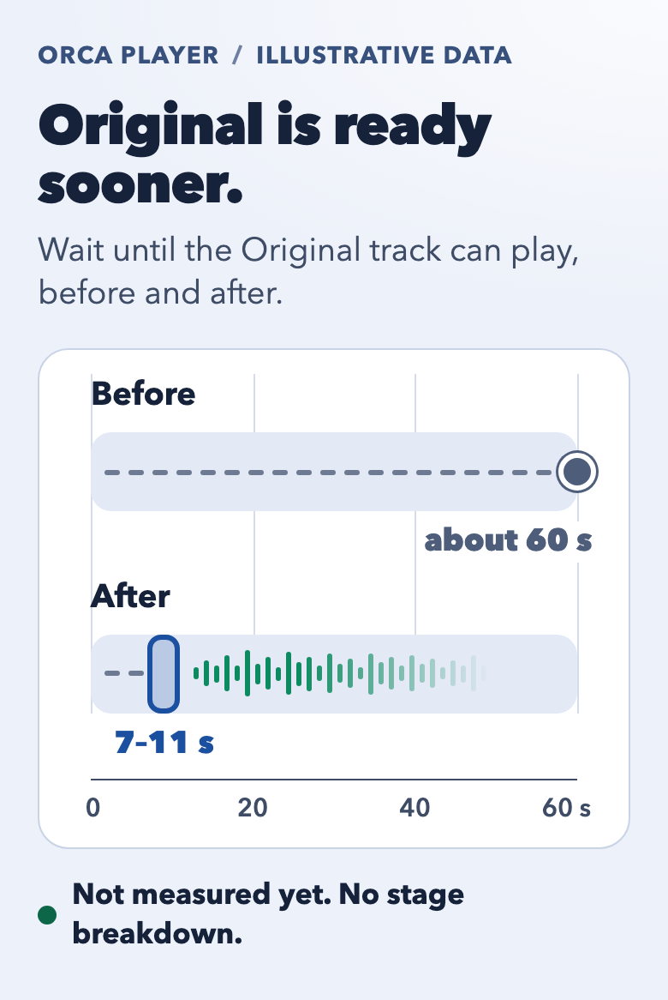
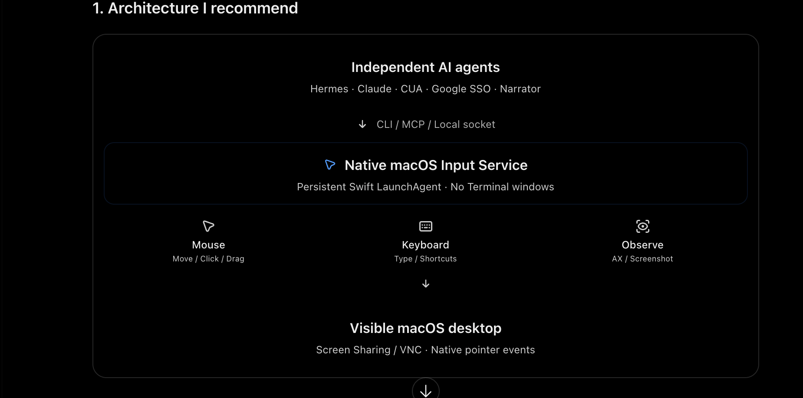
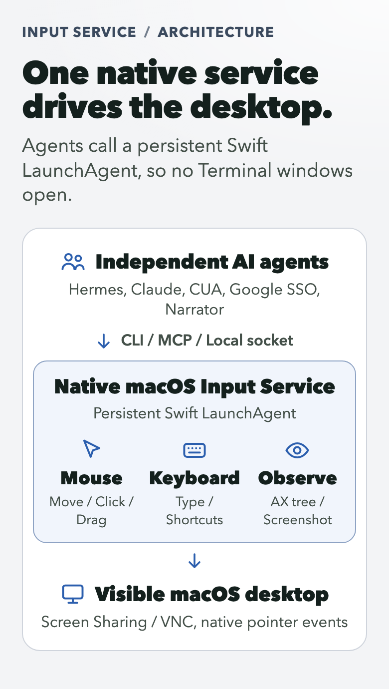
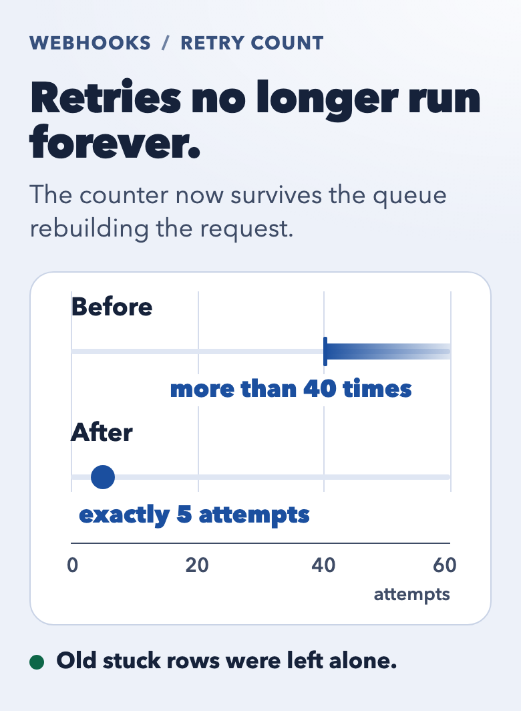

# References, ratings and good/bad pairs

Images are in `images/`. "Reference" is what Max supplied and rated. "Shipped" is the render from the current templates, drawn from the same input text.

Max's rating of the reference set: 6.5/10. "Readable, but they look like formatted summaries." The Orca waveform is the one that works, because you can see which state is playing before you read the label.

## Pair 1: gate log (bugfix, show what looked wrong)

Input: `Gate threshold: there was no off-by-one. The message printed two decimals, so 0.549 showed as '0.55 needs 0.55'. It now prints three.`

| Reference (Max 6/10) | Shipped |
| --- | --- |
|  |  |

Critique of the reference: two separate cards with a caption each is a summary. The evidence is two lines, so show them in one close-up, numbers aligned, and highlight only the precision digits that changed (0.55 against 0.549, 0.55 against 0.550). No cards.

What changed in the shipped one: one block, two aligned mono lines, an empty dashed slot where the BEFORE line has no digit, only the added digits highlighted. The code computes the highlight; the model supplies the two exact strings.

## Pair 2: Orca player (make waiting look different from playing)

Input: `Player timeline colours: 'rest of Original' is grey, the same as 'waits for edited', so playing looks like waiting. Playing should be green.`

| Reference (Max 7/10, dark theme) | Shipped (light) |
| --- | --- |
|  |  |

Critique: keep the dashed waiting line and the green waveform. Right now it reads as a legend, not a demo. Put both in the SAME player slot (a matched before/after crop of the player bar, or a short state switch). No time axis, because the reply gives no timings. The dark theme is not allowed; light palette only.

What changed in the shipped one: the same player bar twice, one above the other, a dashed ring and dashes against a play button and a green waveform. The state is visible before the label is read.

## Pair 3: performance (show how long the listener waits)

Input: `Illustrative values: before about 60 s, after 7 to 11 s.`

| Reference (Max 6.5/10) | Shipped |
| --- | --- |
|  |  |

Critique: the number appears twice (chip and bar) and nothing ties the wait to the player. Show the number once. Put the 7-11 s bracket at the point where Original becomes available in the player. A dot is a value, a bracket is a range, and aligned lanes appear only when timing is known.

What changed in the shipped one: the track is the player bar, dashed while waiting and a green waveform after the bracket. The bracket sits where Original becomes available. Each value is printed once, at its mark. The eyebrow says ILLUSTRATIVE DATA.

## Pair 4: combined player and perf

Merge the player state and the wait only when the timing evidence describes that same player behavior: one real player crop with one visible state change, the measured wait comparison directly under it. Pair 3 is that merge. The gate log stays separate.

## Architecture (recommendation replies)

Input: `Architecture I recommend: independent AI agents ... call a native macOS Input Service over CLI, MCP or a local socket ... Mouse, Keyboard, Observe ... visible macOS desktop.`

| Reference (dark, another tool; not rated) | Shipped (light, layered) |
| --- | --- |
|  |  |

Allowed only as layers: real component names, an icon on each, one flow direction, labels on the arrows, centered text. No bare "Diagram" boxes.

## Open values

Input: the webhook retry reply ("more than 40 times in a minute", now exactly 5 attempts).

"More than 40" is a range with no top, not a dot at 40. It draws as an open bracket running off to the axis end (`open: true`), on an axis with headroom past the number.

## No image

Input: `Lint, typecheck, build and tests all pass (343 tests).` Output: NO_IMAGE. A status line is a sentence.

## Scores

The rubric scores and two-second results for each round are in `scores.md`.
